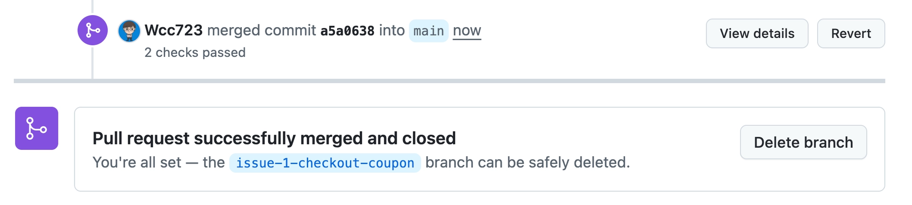

# AI 開發進化營｜第四場作業

> 截止繳交：**2027/1/24（日）23:59**　｜　建議提早於 10/25（日）23:59 前完成，趁記憶猶新時實作

## 作業內容

1. SubAgent 小隊 AI Code Review
2. Issue 驅動開發（手動觸發）
3. Loop 自動化與 CI 回饋

## 注意事項

1. 統一使用第四場作業起始儲存庫：按「Use this template」建立自己的儲存庫，之後的 Issue、PR 都在自己的儲存庫進行。
2. 起始儲存庫是第三場的花卉電商專案，main 中埋有 **5 個問題**（挑戰一要找出來），另加 `tests/acceptance/` 驗收測試；兩個 Issue 的內容見附錄，可直接複製貼到 GitHub。
3. 前置準備：安裝 GitHub CLI 並執行 `gh auth login`，確認 `gh issue list` 能在專案資料夾執行。
4. 以下以 Claude Code 為例，其他工具請自行對應路徑與設定，產出需符合本作業規格。
5. SubAgent 與 Loop 較耗用量，完成後請取消排程；請勿提交 API Key、Token、密碼等機密資料。
6. 若您是 10/14 之後才加入課程，請先觀看【第四場主題講座錄影】與【第四場作業講解錄影】，再開始挑戰作業。

---

## 挑戰一：SubAgent 小隊與 AI Code Review

定義至少 3 個自訂 SubAgent，讓它們分工檢查專案程式碼。起始儲存庫的 main 埋有 5 個問題，現有測試全部通過，請至少找出 3 個，再請 AI 修正。

### (1) 定義 SubAgent

放在 `.claude/agents/`，名稱可自訂；`description` 寫清楚何時派出，內文定義固定的輸出格式。完成後 commit 並推上 main。

| SubAgent | 職責 | 必要設定 |
| --- | --- | --- |
| `security-reviewer` | 權限、身分驗證、金流驗證與輸入驗證 | `tools` 只給唯讀工具（如 Read、Grep、Glob），Review 時不會順手改程式 |
| `code-reviewer` | 業務邏輯與邊界、是否符合規格、測試是否被刪除 / 跳過 / 放寬 | `tools` 只給唯讀工具 |
| `test-runner` | 執行測試，只回報失敗項目、位置與可能原因 | `model` 設為較低規模型（如 sonnet、haiku）；不得有 Edit、Write |

選做：加入 `e2e-tester`，以 `skills` 預載第二場的 E2E Skill、以 `mcpServers` 掛上 Playwright MCP。

### (2) 請 AI 派出 SubAgent 檢查專案

用白話請主 Agent 派出 SubAgent，例如：

```text
請派 security-reviewer 和 code-reviewer 檢查訂單、付款、運費、購物車與相關測試，再派 test-runner 跑 test:unit 和 test:integration。把找到的問題整理到 docs/ai-review.md，這一步先不要修改程式碼。
```

- 提示：問題分布在訂單查詢、付款狀態、運費計算、購物車數量與測試等範圍。
- `docs/ai-review.md` 格式不拘，每個問題寫出**位置**（檔案與行數或函式名稱）與**問題說明**即可；只寫「建議加強驗證」不算找到。

### (3) 請 AI 修正問題

確認 `docs/ai-review.md` 的內容後，請 AI 修正其中的問題並跑過 `test:unit` 與 `test:integration`，連同 `docs/ai-review.md` 一起 commit 並推上 main。

> 共有 5 個錯誤問題，AI 不一定都會抓到，其中有些問題沒修正的話，會在挑戰二的驗收測試中顯現出來。

---

## 挑戰二：Issue 驅動開發（手動觸發）

用 GitHub Issue 承接需求：先用白話帶 AI 走完一次「讀 Issue → 實作 → 測試 → 開 PR → Review」，再請 AI 把這套流程整理成 `work-issue` Skill，至少完成 1 個 Issue。

### (1) 開立 Issue 與鎖定驗收測試

- 請 AI 在你的 GitHub 儲存庫建立 4 個標籤：

  | 標籤 | 意義 |
  | --- | --- |
  | `ready` | 可交給 AI |
  | `in-progress` | 處理中 |
  | `in-review` | PR 待人工合併 |
  | `needs-human` | 需人工介入 |

- 到 GitHub 網頁 Issues → New issue，把附錄 **Issue A** 的標題、內容直接複製貼上（僅 Issue A 加入即可），並在右側 Labels 加上 `ready`。
- `tests/acceptance/` 不得修改：請 AI 在 `.claude/settings.json` 的 `permissions.deny` 加入 `"Edit(./tests/acceptance/**)"`，再 commit 並推上 main。終端機指令仍可能改到檔案，所以 reviewer 也要檢查。

### (2) 用白話帶 AI 完成 Issue A

這一步先不建立 Skill，直接在對話中用白話請 AI 處理 Issue A，流程需包含：

1. 讀 Issue，確認帶有 `ready` 且是自己開的，把標籤改為 `in-progress`
2. 從最新的 main 開分支 `issue-<編號>-<名稱>`
3. 實作，並補上 Unit 或 Integration Test
4. 派 `test-runner` 跑 unit、integration 與該 Issue 的驗收測試（Issue A 為 `npm run test:acceptance -- coupon`）
5. 更新 docs 與 `openapi.json`
6. 開 PR，描述寫上 `Closes #<編號>`
7. 派 reviewer 檢查 PR，有「高」嚴重度的問題就修正
8. 把標籤改為 `in-review` 後停下來
9. GitHub Actions 通過後，由**你本人**在 GitHub 網頁合併 PR，Issue 會自動關閉

參考畫面：PR 合併成功（`_docs/image-1.png`，分支 `issue-1-checkout-coupon`）。



### (3) 請 AI 把流程整理成 Skill

在同一個對話中，請 AI 依照剛才處理 Issue 的流程建立 `.claude/skills/work-issue/SKILL.md`，例如：

```text
把剛才處理 Issue 的流程整理成 work-issue Skill，放在 .claude/skills/work-issue/SKILL.md，用 /work-issue <編號> 呼叫。步驟與邊界都要寫進去，不要包含合併 PR。
```

確認 Skill 包含 (2) 的步驟與邊界後，commit 並推上 main。

---

## 挑戰三：Loop 自動觸發與 CI 回饋

用 `/loop` 定時領取並處理 `ready` 的 Issue，PR 開出後讀取 GitHub Actions 結果，失敗時自動修正。Loop 啟動**後**才加入第二個 Issue（Issue B），最後兩個 Issue 全部關閉。

### (1) 撰寫 `.claude/loop.md`

`/loop` 不帶 prompt 時會使用此檔案。可以請 AI 依下面的精簡格式建立，再依自己的流程調整：

````markdown
# Issue Loop

每輪依序判斷，做完一件事就結束本輪。只看自己開的 open Issue（--author @me --state open）。

1. 有 in-progress：上一輪沒有正常結束，在 Issue 留言說明，改為 needs-human
2. 有 in-review：用 gh pr checks 查 PR 的 CI
   - 失敗：用 gh run view <run id> --log-failed 取得 log，交給 test-runner 分析，修正後推送
   - 執行中或已通過：等待人工合併，本輪不領新的 Issue
3. 有 ready：取建立時間最早的一個，執行 /work-issue <編號>
4. 都沒有：本輪不做事，等待下一輪（作業完成後再手動取消排程）

## 邊界
- 同時只處理一個 Issue，只處理自己開的 Issue
- 修正輪數以 Issue 上的回報留言計算，合計超過 3 輪就改為 needs-human
- 不得合併 PR，不得修改 tests/acceptance/

## 每輪回報
本輪有動作，就在該 Issue 留言：
Loop 回報｜Issue #<編號>｜第 <N> 輪
- 本輪動作：
- CI 狀態：
- 下一步：
````

> 為什麼要 `--author @me`：作業儲存庫是公開的，不過濾就等於讓陌生人寫的 Issue 指揮你電腦上的 AI。

### (2) 啟動 Loop 並加入第二個 Issue

1. 在 Claude Code 執行 `/loop`，設定間隔 1 分鐘（實務上建議 10 分鐘以上）；排程只存在於目前的 session，作業期間請保持開啟。不想開著 session 可改用 Claude Desktop 排程。使用 Codex 請改用 Codex App 的排程任務，並設定在同一個對話中執行；Codex CLI 沒有 `/loop`，請勿以 CLI 實作。
2. **開啟錄影。**
3. Loop 啟動後，再到 GitHub 網頁貼上第二個 Issue（Issue B）並加上 `ready`。
4. 將 Loop 自動讀取 Issue 的過程錄製下來。
5. 完成後確認：兩個 Issue 全部關閉、每輪都有回報留言、截下排程任務清單，並已取消排程。

如果沒有正確錄到，可以隨意開一個 Issue 觸發 Loop。

---

## 附錄：兩個 Issue 的規格

「標題」貼到 Title，程式碼區塊的內容貼到描述欄位。挑戰二開立 Issue A，挑戰三在 Loop 啟動後開立 Issue B。API 的實際路徑與請求格式以驗收測試為準，前端畫面為選做。

### Issue A：結帳優惠碼

**標題：** `結帳優惠碼`

````markdown
## 功能說明
結帳時可輸入一組優惠碼折抵商品金額。比照第三場 Shipping 模組，將優惠碼規則集中在 `src/utils/` 的 Coupon 模組。

| 優惠碼 | 折扣內容 | 使用條件 |
| --- | --- | --- |
| `FLOWER100` | 折抵 100 元 | 商品小計滿 800 元 |
| `SPRING10` | 商品小計打 9 折，最多折抵 300 元 | 無門檻 |
| `SUMMER50` | 折抵 50 元 | 已失效，不可使用 |

## 規則或規格
- 每張訂單最多使用 1 組優惠碼，優惠碼不分大小寫
- 優惠只折抵商品小計，不折抵運費
- 免運門檻（1,500 元）以折扣後的商品小計判斷
- 折扣金額四捨五入至整數
- 訂單總額 = 商品小計 - 折扣 + 運費
- `POST /api/orders` 可傳入 `couponCode`（選填），訂單需記錄優惠碼與折扣金額；`GET /api/orders/:id` 也要回傳 `coupon_code` 與 `discount`
- 建立訂單成功時，回應的 `data` 需包含 `subtotal`、`discount`、`shipping_fee`、`total_amount`、`coupon_code`（沿用專案 snake_case 慣例；未使用優惠碼時 `discount` 為 0；`coupon_code` 以大寫記錄）
- 無效、已失效或未達門檻的優惠碼：回傳 400 與錯誤訊息，不建立訂單、不扣庫存、不清空購物車

## 驗收條件
- `FLOWER100`：小計 800 元可使用，799 元回傳 400
- `SPRING10`：小計 1,000 元折 100 元、小計 1,234 元折 123 元、小計 3,500 元折 300 元（上限）
- `SUMMER50` 回傳 400
- 小計 1,550 元使用 `FLOWER100`，折扣後 1,450 元，宅配需收 120 元運費
- 小寫 `flower100` 可正常使用
- 小計 1,600 元使用 `FLOWER100`，折扣後剛好 1,500 元，免基本運費
- 未使用優惠碼時 `discount` 為 0，其餘金額與原本相同
- `GET /api/orders/:id` 回傳使用的優惠碼與折扣金額
- 使用無效優惠碼時，訂單數量、庫存與購物車皆不變

## 驗收測試
`tests/acceptance/coupon.test.js`（執行 `npm run test:acceptance -- coupon`），不得修改

## 不在本次範圍
- 後台管理優惠碼（新增、停用、修改）；三組優惠碼可直接寫在 Coupon 模組中
- 使用次數上限、每人限用次數
- 前端結帳頁的優惠碼輸入欄位（選做）
````

### Issue B：我的訂單篩選與分頁

**標題：** `我的訂單篩選與分頁`

````markdown
## 功能說明
會員查詢自己的訂單時，可以依狀態篩選並分頁。

## 規則或規格
- `GET /api/orders` 支援 `status`（`pending`、`paid`、`failed`）、`page`（預設 1）、`limit`（預設 10，最大 50，超過以 50 計）
- 只回傳自己的訂單，依建立時間由新到舊排序
- 回應格式沿用專案列表 API 的慣例（與 `GET /api/admin/orders` 相同）：`{ data: { orders: [...], pagination: { page, limit, total, totalPages } }, error, message }`
- `status` 不在允許值內，或 `page`、`limit` 不是正整數：回傳 400
- 既有前端訂單頁需配合新格式正常顯示

## 驗收條件
- 不帶參數時回傳第 1 頁、每頁 10 筆，依建立時間由新到舊
- `status=paid` 只回傳已付款訂單
- 12 筆訂單、`limit=5` 時，第 3 頁有 2 筆，`totalPages` 為 3
- `limit=100` 時以 50 計
- `status=unknown`、`page=0`、`limit=-1` 回傳 400
- 不會回傳其他會員的訂單

## 驗收測試
`tests/acceptance/order-filter.test.js`（執行 `npm run test:acceptance -- order-filter`），不得修改

## 不在本次範圍
- 後台訂單列表（`GET /api/admin/orders`）的調整
- 依日期區間或關鍵字搜尋
- 前端訂單頁的篩選與分頁 UI（選做）
````

---

## 繳交內容

**GitHub 儲存庫**：請提供本次作業的儲存庫網址，並附上以下資訊：

- 使用的 AI Agent，例如 Claude Code、Codex CLI
- 你的挑戰等級（LV1、LV2、LV3）
- 使用的作業系統，例如 Windows PowerShell、WSL2、macOS
- 新增或調整的環境變數名稱
- 請勿提交 API Key、Token、密碼或其他機密資料

> **LV3 需額外繳交：**
> - 本地 Loop 觸發第二個 Issue 的畫面或影片（影片可上傳至 YouTube 並選擇不公開）
> - 排程任務清單截圖（證明已設定排程或已取消）

## 挑戰等級與檢核清單

### LV 1

至少 3 個自訂 SubAgent（reviewer 唯讀、test-runner 用較低規模型），`docs/ai-review.md` 找出至少 3 個埋設問題，並請 AI 修正後推上 main。

- [ ] 3 個 SubAgent 定義於 `.claude/agents/`
- [ ] `docs/ai-review.md` 列出 ≥ 3 個問題（含位置與說明）
- [ ] 問題已修正，`test:unit`、`test:integration` 通過
- [ ] 已 commit 並推上 main

### LV 2

LV1 加上 4 個標籤、以 GitHub 網頁開立 Issue A、驗收測試鎖定，用白話帶 AI 完成至少 1 個 Issue（經 PR 合併關閉，驗收測試與 GitHub Actions 皆通過），並將流程整理成 `work-issue` Skill。

- [ ] 4 個標籤已建立
- [ ] Issue A 由網頁開立並加上 `ready`
- [ ] `.claude/settings.json` 已 deny `tests/acceptance/**`
- [ ] Issue A 經 PR 合併關閉（驗收測試與 Actions 通過）
- [ ] `.claude/skills/work-issue/SKILL.md` 已 commit 並推上 main

### LV 3

LV2 加上 `.claude/loop.md`；Loop 啟動後開立第二個 Issue（Issue B），並附上本地 Loop 觸發處理的截圖；至少 1 個 Issue 由 Loop 處理並關閉、兩個 Issue 全部完成、每輪都有回報留言，結束後已取消排程。

- [ ] `.claude/loop.md` 已建立
- [ ] Loop 啟動後才開立 Issue B
- [ ] 至少 1 個 Issue 由 Loop 處理並關閉
- [ ] 兩個 Issue 皆關閉，每輪皆有回報留言
- [ ] 已截圖 / 錄影，並已取消排程
